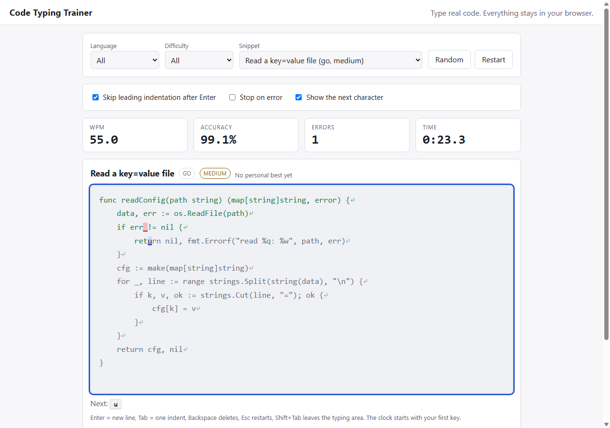

# code-typing-trainer

A typing trainer for programmers that runs entirely in the browser. Pick a code snippet (JavaScript, Python, SQL, Go, Rust, shell, HTML, CSS or JSON) and type it: correct characters turn green, mistakes turn red, and the cursor shows the next character you need. It has no dependencies and no build step. It is a learning and showcase project, not a replacement for a full typing course.



*The screenshot was taken with a scripted run and a faked clock, so the WPM and time shown in it are not a real typing speed.*

## What it does

- 18 original snippets, 4 to 15 lines each, with real symbols (`{}[]()<>=>;:"'\|&*`), indentation, tabs (Go) and blank lines. Pick by language and difficulty, or press Random.
- Live WPM, accuracy, errors and elapsed time while you type.
- A results screen with WPM, accuracy, time, the characters you missed most (counted by the character you were supposed to type), and a comparison with your personal best for that snippet.
- History (last 100 runs) and personal bests in this browser's local storage. Nothing is sent anywhere.
- Options, remembered between visits:
  - **Skip leading indentation after Enter** (default on).
  - **Stop on error** (default off): a wrong key is rejected and the cursor waits, instead of recording the mistake and moving on.
  - **Show the next character** hint (default on). It is a text hint, not a keyboard picture.
  - Light and dark themes follow the system setting.
- Keys: Enter types a newline, Tab types the snippet's indent unit (two or four spaces, or a tab for Go), Backspace deletes, Esc restarts. Shift+Tab leaves the typing area.

## Run it

Needs Node 20 or newer, only to serve static files and to run the tests.

```
npm start            # http://127.0.0.1:8080/   (PORT=3000 npm start to change the port)
npm test             # node --test
```

Any static server works, for example `python -m http.server`. `npm start` serves only `index.html` and `src/`. Click the typing area (or pick a snippet) and start typing; the clock starts at your first key.

## How WPM and accuracy are defined

The precise rules are in the header comment of `src/session.js` and are pinned by tests.

- **WPM** = correct characters / 5, per minute of elapsed time. "Correct characters" are the positions that currently hold a correct character that you typed. Wrong characters still in the text do not count. `grossWpm` (returned by the session, not shown in the UI) counts every character in the buffer, wrong ones included.
- **Clock**: starts at the first accepted keystroke, stops at the keystroke that completes the snippet. Backspace at the start and ignored keys do not start it. The first character is free. WPM is 0 while elapsed time is 0.
- **Error**: the first wrong attempt at a position counts once for that position, even if you fix it with Backspace, and repeating the same wrong key at the same position does not add more.
- **Accuracy** = (positions attempted - errors) / positions attempted. Nothing attempted yet reads 100%.
- **Skipped indentation** (auto-indent on) counts toward neither WPM nor accuracy, so turning it off lowers your WPM only because you type more characters, not because the formula changed.
- **Finished** means the cursor is at the end and no wrong character remains. In the default mode you can reach the end with mistakes; then you backspace and fix them.

## How it is built

```
index.html, src/styles.css   page and styling
src/app.js                   DOM only: rendering with createElement/textContent (never innerHTML), key handling, timer, storage
src/session.js               the typing-session state machine; the clock is injected, so it is pure and deterministic
src/lib.js                   snippet validation and picking, key-to-action mapping, formatting, history and personal-best store
src/snippets.js              the snippet data
scripts/serve.js             the static server behind `npm start`
test/                        node:test suites
```

`session.js`, `lib.js` and `snippets.js` are UMD modules: plain scripts in the page, `require()` in Node, so the tests exercise the same files the browser loads. The session never reads the time itself; `type(char, now)`, `backspace(now)` and `stats(now)` take it as an argument. The page passes `performance.now()`.

## How it is tested

Run `npm test` (Node's built-in runner, no dependencies). 163 tests, all passing on Node 24 on Windows, deterministic (no real clock, no unseeded randomness):

- **Session rules** (`session.test.js`, 59 tests): the injected clock decides everything. Known answers: 50 correct characters in 60 s is exactly 10 WPM, 100 in 30 s is exactly 40 WPM, a mid-run reading, and 2 errors in 10 positions is 80% accuracy. Also: WPM is 0 at elapsed 0 (including a whole snippet typed in zero time), the clock starts at the first key and stops at the last correct one, a clock that goes backwards gives 0 elapsed, non-finite times throw, Backspace at position 0, typing after finish, mistake-then-correct (error stays counted), the same position counted once, stop-on-error, the Tab key, and auto-indent over spaces, tabs, mixed whitespace and blank lines (including that one Backspace undoes one Enter).
- **Property tests, seeded** (`session.test.js`): 40 seeds of 500 random type/backspace/tab/restart operations over the real snippets and some nasty hand-made ones, in all four option combinations. After every step: cursor in `[0, length]`, marks consistent with the cursor, no NaN or Infinity, accuracy in 0 to 100, errors <= typed <= length, per-key errors add up to the error count, errors never decrease between restarts, finished implies cursor at the end with no wrong character, and a finished session is frozen. Two model-based tests drive a typist who makes random slips and fixes them (continue mode) or presses random wrong keys (stop mode) and compare the session's error and attempted counts with an independent count kept by the test.
- **Snippets** (`snippets.test.js`, 58 tests): 18 snippets, unique ids and texts, every language and difficulty present, 4 to 15 lines, only keys the handler can produce, no trailing spaces, no tab/space mixes, a spread of symbols. For every snippet, a scripted perfect typist finishes with exactly 100% accuracy and 0 errors with auto-indent on and off, and again through real key events (`Enter`, `Tab` for whole indent units) including stop-on-error. The JSON snippet is parsed with `JSON.parse` and the JavaScript ones are compiled (never run) with `vm.Script`.
- **Helpers** (`lib.test.js`, 37 tests): the validator on bad input (each rule), snippet picking with an injected random function, the key mapping (shortcuts, IME events, AltGr, Shift+Tab), formatting, the personal-best comparison, and the history store with corrupt, wrongly shaped, missing, throwing and full storage, a 100-entry cap, and per-entry cleaning.
- **Page and server** (`page.test.js`, `serve.test.js`, 9 tests): static checks that the UI code uses no HTML-string APIs, every element id used by `app.js` exists in `index.html`, scripts load in order, nothing is fetched from the network; and path traversal attempts against the static server.

I also checked that the tests can fail: I broke the session on purpose in four ways (count every wrong attempt as an error, use gross characters for WPM, disable the auto-indent skip, let a run finish with wrong characters left). Three were caught by failing tests; the fourth made one test loop forever (a Backspace that was ignored too early), which I killed. That is a crude check, not mutation testing.

**Browser check (manual, done once, headless Chrome only).** I copied the app to a scratch directory, added a throwaway script that dispatches real `KeyboardEvent`s at the typing element, served it on a local port and dumped the DOM with `chrome --headless=new --dump-dom`. It typed a Python snippet perfectly (auto-indent on), pressed Esc mid-run, typed a JavaScript snippet with deliberate mistakes fixed by Backspace, typed a Go snippet with auto-indent off through Enter and Tab, ran stop-on-error mode, beat and then failed to beat a personal best, and toggled the hint. It checked the red and green classes, the results screen, the personal best in `localStorage`, history rows, and that the handled keys were `preventDefault`ed (all but Tab after finishing, by design). Everything behaved as described and the browser run found no bug in the app. The screenshot in `docs/` came from the same method. The script is throwaway and is **not in this repo**, so the browser UI has no automated test. That run used a faked `performance.now()` so the numbers were predictable; the WPM figures in it only prove the page wires the clock through, and the WPM definition itself is verified by the Node tests above.

## Limits

- **Input is keydown only.** Keys are captured with `keydown` on a focused element. There is **no IME support** (composition events are ignored) and **no mobile soft-keyboard support**: on a phone or tablet soft keyboard `keydown` often reports `Unidentified`, and I did not try. Dead keys (accents typed as two keystrokes) are ignored. Only physical-keyboard typing on desktop is meant to work.
- **Verified in Chrome only**, headless, once, by hand, as described above. Firefox, Safari and Edge are untested. Not verified at all: real typing speed on a real keyboard, key repeat, non-US keyboard layouts (AltGr characters are handled in the key mapping and unit-tested, but not tried on hardware), screen readers (the typing area has an ARIA label and a polite status message on finish, nothing more), and the dark theme (CSS only; the screenshot is the light theme).
- **WPM is your typing speed on this text, not a certified measure.** The first character is free (the clock starts at the first key), and very short snippets are noisy. The live number shows a dash for the first second because one fast key gives hundreds of WPM.
- **Personal best is highest WPM, ties broken by accuracy.** A sloppy run with a high WPM can beat a careful one. Auto-indent on and off give different WPM for the same snippet, and the best does not distinguish them.
- **The wrong character shown is the expected one**, not the key you pressed (red highlight on the character you should have typed). What you actually pressed is not recorded; the per-key list counts the characters you were supposed to type.
- **Snippets are my own and only partly machine-checked.** JSON is parsed, JavaScript is compiled, and I ran the Python and shell ones through `ast.parse` and `bash -n` once by hand. The Go, Rust, SQL, HTML and CSS snippets were never compiled or run, so one may contain a slip. Difficulty labels are my judgement.
- 18 snippets, all in this repo's data file; there is no way to paste your own text in the UI.
- History is the last 100 runs per browser. Clearing site data clears it. No accounts, sync, or leaderboard. Changing an option mid-run starts a fresh run.
- Not deployed anywhere. To publish it, enable GitHub Pages for the repository and serve the repository root.
- CI not yet confirmed. The workflow (`.github/workflows/ci.yml`) runs `npm test` on Node 20, 22 and 24, but it has not run on GitHub yet.

## Clone

```
git clone https://github.com/Sup3rMar10/code-typing-trainer.git
cd code-typing-trainer
npm start
```

MIT licensed.
